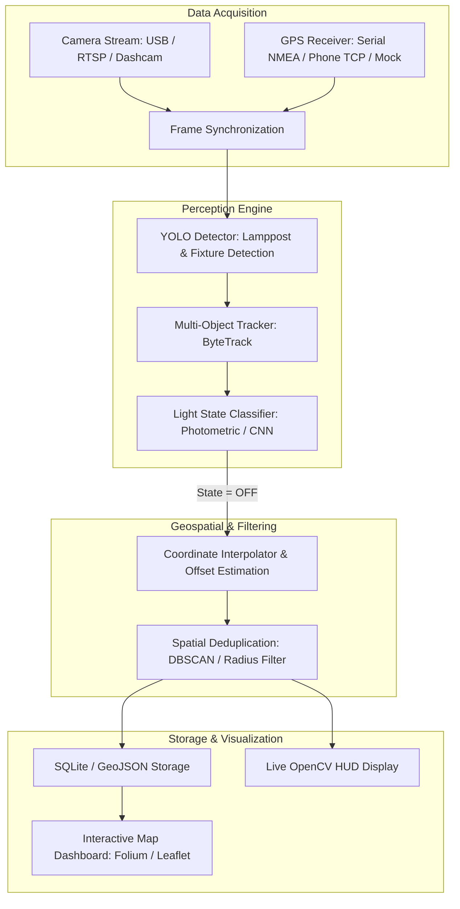
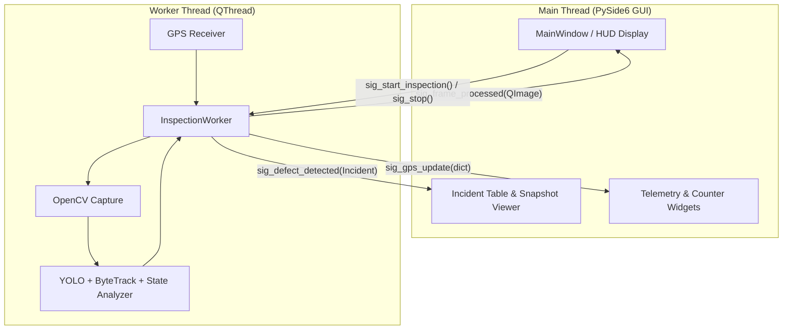

# 🌙 Nighttime Streetlight Defect Detector (Ljósastaurar)
**Autonomous Fault Detection & GPS Geotagging System for Municipal Streetlights**

---

## 1. Project Overview & Objective

The goal of this project is to build an automated, vehicle- or mobile-mounted computer vision system that monitors street lighting at night. As a vehicle drives along streets, the system uses a live video stream to detect streetlights (lampposts), evaluates whether each lamp is illuminated or defective (unlit / dark), and logs the GPS coordinates of broken lights to a database or geospatial map.

---

## 2. Key Challenges & Technical Approaches

Detecting unlit streetlights at night presents unique challenges compared to standard daytime object detection:

| Challenge | Why it happens | Proposed Solution |
| :--- | :--- | :--- |
| **Darkness Visibility** | An unlit streetlight emits no light and blends into the pitch-black sky. | **Dual Detection Strategy**: Rely on vehicle headlights illuminating the pole/fixture within 20–40m, OR use GIS/OpenStreetMap prior locations to know where lamps *should* be. |
| **Glare & Bloom** | Working lamps create lens flare and overexposure in low-light camera sensors. | Dynamic exposure control / ROI masking, or detecting the bulb housing separately from the light halo. |
| **Duplicate Logging** | A single broken lamppost appears across 30–60 consecutive video frames as the car drives past. | Multi-object tracking (ByteTrack / DeepSORT) + spatial deduplication (clustering alerts within ~15–20m into a single incident). |
| **GPS Sensor Latency** | Commercial GPS updates at 1Hz (once per sec), while video runs at 30 FPS. | Threaded GPS reader with temporal interpolation against camera timestamps. |

### Two Primary Paradigms

```
┌────────────────────────────────────────────────────────────────────────┐
│ Option A: Pure Computer Vision (Headlight-Illuminated Poles)           │
│ - Detects lamppost structure in front of the vehicle via car beams.    │
│ - Checks bulb region: Is luminous intensity above threshold?           │
│ - Pros: Requires no prior map data; works anywhere.                    │
│ - Cons: Only detects lamps within headlight range (~30m).              │
└────────────────────────────────────────────────────────────────────────┘

┌────────────────────────────────────────────────────────────────────────┐
│ Option B: Hybrid GIS + Computer Vision (Municipal Standard)            │
│ - Pulls known streetlight locations (OpenStreetMap / City GIS).        │
│ - When GPS enters within R meters of a known lamp coordinate:          │
│   Camera scans expected angle. If no light source found -> Flagged OFF.│
│ - Pros: 100% detection rate of unlit lamps regardless of illumination. │
│ - Cons: Requires baseline map/database of pole coordinates.            │
└────────────────────────────────────────────────────────────────────────┘
```

> **Recommendation**: Start with **Option A (Vision-First)** using object detection + luminance evaluation, with architectural hooks to support **Option B (GIS validation)** later.

---

## 3. High-Level Architecture & Pipeline



---

## 4. Software Pipeline Breakdown

### 4.1 Input Ingestion
* **Camera Feeds**:
  * Live USB Webcam / Dashcam (`cv2.VideoCapture`).
  * RTSP/HTTP stream from an IP camera or mobile app (e.g., IP Webcam).
  * Recorded test video clips (`.mp4`) for testing before live deployment.
* **GPS Feeds**:
  * USB GPS dongle (u-blox NEO-6M / G-Mouse) reading NMEA sentences (`pyserial` + `pynmea2`).
  * Smartphone GPS via UDP/TCP broadcast (apps like GPS Logger or OsmAnd).
  * Mock GPS track reader (GPX/CSV replay synced to video playback time).

### 4.2 Perception & Detection
1. **Object Detection**:
   * **Model**: YOLOv8 or YOLO11 Nano (`yolov8n.pt` / `yolo11n.pt`) fine-tuned for night street scenes.
   * **Classes**:
     * `streetlight_on`: Visible active luminaire with characteristic glare / color temperature.
     * `streetlight_off`: Pole and luminaire housing visible via headlight illumination, but zero emission.
2. **Alternative Two-Stage Method**:
   * Stage 1: Detect `streetlight` bounding box.
   * Stage 2: Crop luminaire head $\to$ calculate HSV / V-channel (luminance) peak and area saturation. If top 5% brightest pixels < threshold $\tau$, mark as **OFF**.

### 4.3 Tracking & Deduplication
* Without tracking, a single broken lamppost at 30 FPS will register hundreds of alerts.
* **ByteTrack** assigns a unique tracking ID (`track_id`) as the vehicle approaches.
* The state (ON/OFF) is aggregated across the track lifetime (majority voting or temporal smoothing).
* **Spatial Deduplication**: When a pole leaves the frame, record its approximate location. If another "OFF" detection occurs within 15 meters within 1 minute, merge them.

### 4.4 Data Logging & Export
* **Output Formats**:
  * `alerts.geojson`: Directly importable into QGIS, Google Earth, or Mapbox.
  * `inspections.db`: SQLite database storing:
    * `timestamp`
    * `latitude`, `longitude`, `altitude`
    * `confidence`
    * `status` (`OFF`, `FLICKERING`, `ON`)
    * `snapshot_path` (crop or full frame image of the broken lamp for proof)

---

## 5. PySide6 Desktop GUI Architecture

To operate the system in real time from a vehicle (laptop or touchscreen display), a **PySide6 (Qt for Python)** desktop application is used.

### 5.1 Multi-Threaded Architecture (Qt Signals & Slots)
Running real-time computer vision (30 FPS) and serial GPS reading directly on the GUI thread will freeze the user interface. Therefore, processing is decoupled using a dedicated worker thread:



### 5.2 User Interface Layout & Features
* **Live Video HUD**: Displays the camera feed with real-time bounding boxes (Green = ON, Red = OFF), tracking IDs, and current FPS.
* **Telemetry Dashboard**:
  * GPS Status: Fix type (2D/3D/None), Latitude, Longitude, Heading, Speed (km/h), Satellite count.
  * System Stats: Total Streetlights Passed, Functioning count, Faulty count, Battery/CPU usage.
* **Incident Log Table**:
  * Real-time list of detected defective lamps.
  * Shows timestamp, GPS coordinates, and a clickable thumbnail that opens full-resolution image proof.
* **Control Bar**:
  * Input source selector (Webcam `0`, Video File `.mp4`, or RTSP stream).
  * GPS mode selector (USB Serial dongle vs. Mock simulation).
  * "Start / Pause Inspection" and "Export GeoJSON / Map" buttons.

---

## 6. Project Directory Structure

```text
ljosastaurar/
├── README.md                 # Setup and run instructions
├── PROJECT_SPECIFICATION.md  # Detailed technical specs and roadmap
├── requirements.txt          # Python dependencies
├── config/
│   └── settings.yaml         # Camera resolution, GPS port, thresholds, model paths
├── src/
│   ├── __init__.py
│   ├── main.py               # Application launcher (CLI or GUI mode)
│   ├── capture/
│   │   ├── __init__.py
│   │   ├── video_stream.py   # Threaded video capture (Webcam, RTSP, Video File)
│   │   └── gps_receiver.py   # NMEA serial reader & mock GPX player
│   ├── detection/
│   │   ├── __init__.py
│   │   ├── detector.py       # YOLO inference wrapper
│   │   ├── tracker.py        # Multi-object tracker (ByteTrack)
│   │   └── state_analyzer.py # On/Off photometric analysis logic
│   ├── geo/
│   │   ├── __init__.py
│   │   ├── spatial_filter.py # Deduplication & distance clustering
│   │   └── osm_helper.py     # (Optional) Overpass API query for streetlight nodes
│   ├── gui/
│   │   ├── __init__.py
│   │   ├── main_window.py    # PySide6 Main Dashboard Window
│   │   ├── video_widget.py   # High-FPS OpenGL/QPainter video viewport
│   │   ├── telemetry_panel.py# GPS coordinates & live stats panel
│   │   ├── incident_table.py # Table of flagged defective lamps + thumbnail popup
│   │   └── worker.py         # QThread worker orchestrating the CV & GPS loop
│   └── storage/
│       ├── __init__.py
│       ├── database.py       # SQLite database manager
│       └── exporter.py       # GeoJSON & CSV export utilities
├── data/
│   ├── sample_videos/        # Test clips recorded at night
│   ├── mock_tracks/          # GPX/NMEA logs for offline testing
│   ├── snapshots/            # Saved frame evidence for detected faulty lamps
│   └── outputs/              # GeoJSON and SQLite files
└── models/
    └── yolov8n_streetlights.pt  # Trained / fine-tuned weights
```

---

## 6. Python Tech Stack & Dependencies

```txt
# Core Vision & AI
opencv-python>=4.8.0
ultralytics>=8.3.0
torch>=2.0.0
torchvision>=0.15.0

# GPS & Geospatial
pyserial>=3.5
pynmea2>=1.19.0
geopy>=2.4.0
shapely>=2.0.0
gpxpy>=1.6.0

# GUI Application
PySide6>=6.6.0

# Visualization & Mapping
folium>=0.17.0
matplotlib>=3.8.0

# Data & Config
numpy>=1.24.0
pydantic>=2.5.0
pyyaml>=6.0.1
```

---

## 7. Hardware Requirements & Selection Guide

Operating an autonomous computer vision system from a moving vehicle at night introduces specific physical constraints: low ambient light, motion blur, vehicle speed, and power delivery.

### 7.1 Camera: Low-Light Sensitivity & Optics
Standard webcams suffer from severe digital noise and slow shutter speeds in the dark, turning streetlights into blurred streaks.
* **Sensor Requirement**: Back-illuminated sensors with high quantum efficiency, specifically **Sony STARVIS / STARVIS 2** series (e.g., IMX462, IMX327, IMX415).
* **Lens Optics**:
  * **Aperture**: $f/1.4$ to $f/1.8$ (captures maximum light before sensor gain introduces noise).
  * **Field of View (FOV)**: $70^\circ$ to $90^\circ$. Avoid $>120^\circ$ fisheye lenses (distant poles become too small) and narrow $<50^\circ$ lenses (poles leave frame too quickly when turning).
* **Recommended Hardware**:
  * **Top Recommendation**: **Arducam 1080p Ultra Low Light USB Camera (Sony IMX462)** (~$55). Native UVC Linux support (`/dev/video0`), excellent near-infrared/low-light sensitivity.
  * **Higher Resolution Alternative**: **Arducam 4K STARVIS USB (IMX415)** (~$85) for detecting fixtures at greater distances (40–50m).
  * **Automotive Alternative**: **VIOFO A119 Mini 2 / A229 Dashcam** (Sony STARVIS 2 IMX675) operated in USB webcam/RTSP mode.

### 7.2 GPS Receiver: Update Frequency & Fix Latency
* **The 1 Hz Problem**: At a typical urban speed of 50 km/h (14 m/s), a standard 1 Hz GPS only updates every 14 meters. A lamppost detected between updates will have up to 14m of positional drift.
* **Recommended Solution**: **10 Hz Multi-GNSS Receiver** (e.g., **u-blox NEO-M8N or NEO-M9N** with USB interface, ~$25–$45).
  * At 10 Hz, position updates occur every **1.4 meters** at 50 km/h.
  * Multi-constellation support (GPS + GLONASS + Galileo) ensures 12–20 satellites in view.
  * External active magnetic patch antenna mounted on the vehicle's metal roof prevents cabin attenuation.
* **Zero-Cost Prototyping Option**: Broadcast smartphone GPS at 1–5 Hz over local Wi-Fi/Hotspot via UDP/TCP using apps like *GPS Logger* or *Sensorstream GPS*.

### 7.3 Compute Platform (YOLO + PySide6 Processing)
The system must run 1080p video ingestion, YOLOv8/YOLO11 inference at $\ge 20$ FPS, tracking, and the PySide6 UI without latency.

| Platform | In-Vehicle Usability | AI Performance | Approx. Cost | Recommendation |
| :--- | :--- | :--- | :--- | :--- |
| **Laptop with NVIDIA GPU** (RTX 3050/3060/4060) | Excellent for dev/testing. Battery + screen in passenger seat. | 60+ FPS (TensorRT / CUDA) | Existing / ~$700+ | **Best for Development** |
| **NVIDIA Jetson Orin Nano (8GB)** | Compact edge box, 7–15W, powered directly from 12V. | 50–70 FPS (TensorRT) | ~$499 | **Best for Dedicated In-Vehicle Rig** |
| **Intel Mini-PC** (Intel N100 / 12th Gen i5) | Small form factor, 12V barrel jack power. | 25–35 FPS (OpenVINO FP16) | ~$150 – $300 | **Budget Dedicated Option** |
| **Raspberry Pi 5** | Requires PCIe AI HAT (Hailo-8 / Coral) for 30 FPS. | 8–12 FPS (CPU only, insufficient) | ~$90 + HAT | Only with AI Accelerator HAT |

### 7.4 Vehicle Rigging & Power Accessories
* **Windshield Mount**: Heavy-duty industrial suction mount placed inside the windshield wiper sweep zone to maintain clear optics in rain/snow.
* **Antenna Placement**: Magnetic antenna placed on the vehicle roof center for maximum sky exposure and ground plane gain.
* **Power Supply**: 12V cigarette lighter USB-PD adapter (65W–100W) or direct 12V-to-19V DC-DC converter for stable laptop/mini-PC operation while vehicle alternator is running.

### 7.5 Hardware Options & Bill of Materials (BOM)

#### Option 1: Smartphone + Laptop ($0 Upfront Cost - Recommended to Start)
* Use your existing smartphone (mounted on the windshield) running *IP Webcam* or *GPS 2 IP*.
* Streams 1080p video and GPS coordinates over local Wi-Fi / Hotspot to the laptop.
* Total hardware outlay: **$0**.

#### Option 2: Dedicated In-Vehicle Hardware (Long-Term Municipal Setup)
| Item | Model / Description | Price Range |
| :--- | :--- | :--- |
| **Camera** | Arducam Sony IMX462 Ultra Low Light USB | $50 – $70 |
| **GPS** | u-blox NEO-M8N USB with magnetic antenna (10Hz) | $25 – $45 |
| **Mounting** | Windshield twist-lock suction bracket | $15 – $25 |
| **Power** | 12V 65W/100W USB-C PD or laptop car charger | $20 – $35 |
| **Compute** | Laptop with NVIDIA GTX 960 (already available) | $0 |
| **Total Hardware Outlay (Dedicated)** | | **~$110 – $175** |


---

## 8. Step-by-Step Implementation Roadmap

### Phase 1: Prototype with Recorded Video & Simulated GPS
- [ ] Set up project structure, virtual environment, and dependencies.
- [ ] Create `video_stream.py` that can load a video file or webcam.
- [ ] Implement a Mock GPS provider (`gps_receiver.py`) that returns coordinates based on timestamps or video frame count.
- [ ] Build a preliminary detector (pretrained YOLOv8 or heuristic luminance thresholding).
- [ ] Build initial PySide6 dashboard shell (`main_window.py` + `worker.py`).
- [ ] Test the pipeline on a recorded nighttime driving clip.

### Phase 2: Refine Lamp Detection & State Classification
- [ ] Label or source a small dataset of nighttime street scenes (illuminated poles vs unlit poles).
- [ ] Fine-tune YOLO or implement the two-stage approach (detector + headlight-illuminated fixture analyzer).
- [ ] Integrate tracking (ByteTrack) to stabilize IDs across frames.

### Phase 3: Hardware Integration (Live Camera + GPS Dongle)
- [ ] Connect a live USB camera or smartphone RTSP camera feed.
- [ ] Connect a real USB GPS receiver (reading `/dev/ttyUSB0` or `/dev/ttyACM0`).
- [ ] Handle GPS fix acquisition, dropout, and coordinate interpolation.

### Phase 4: Output & Visualization
- [ ] Save detected faulty lamps with snapshots into SQLite.
- [ ] Export findings into `faulty_lamps.geojson`.
- [ ] Generate an interactive HTML map with Folium showing the route driven and red markers for defective lamps.

